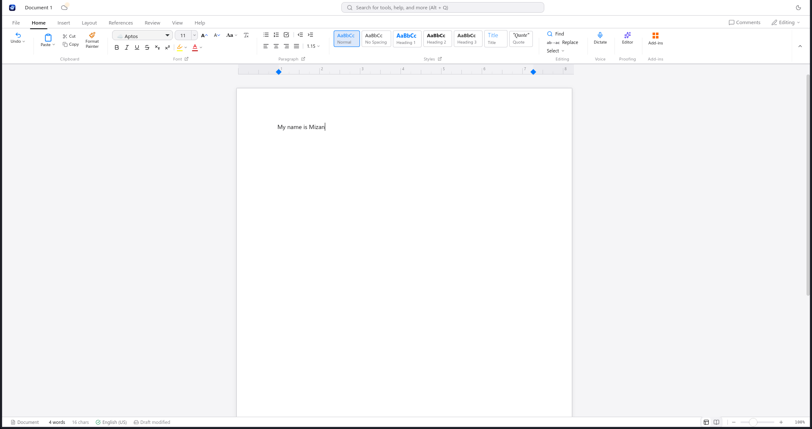
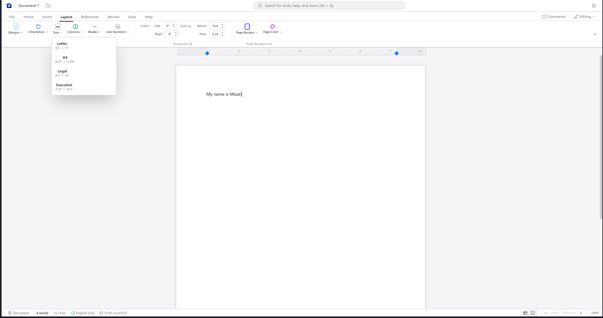
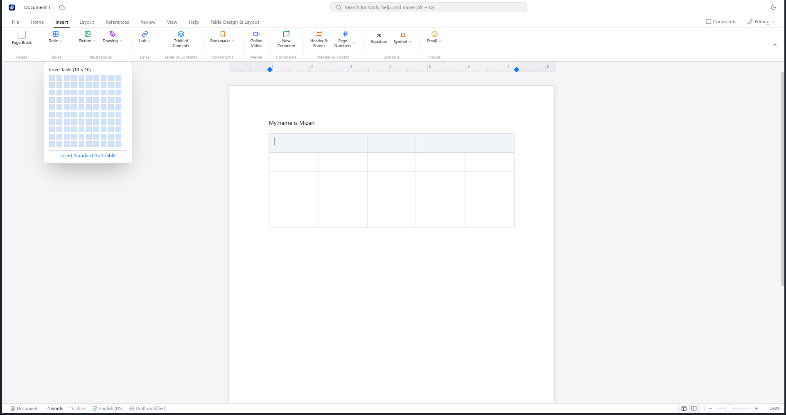
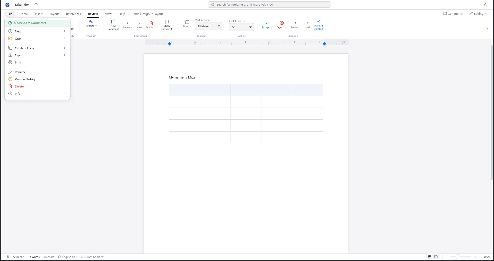
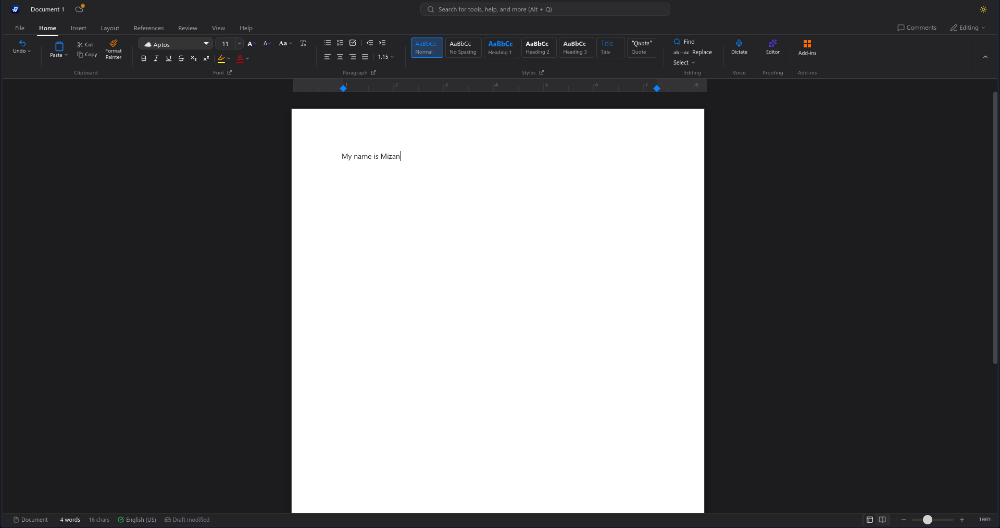
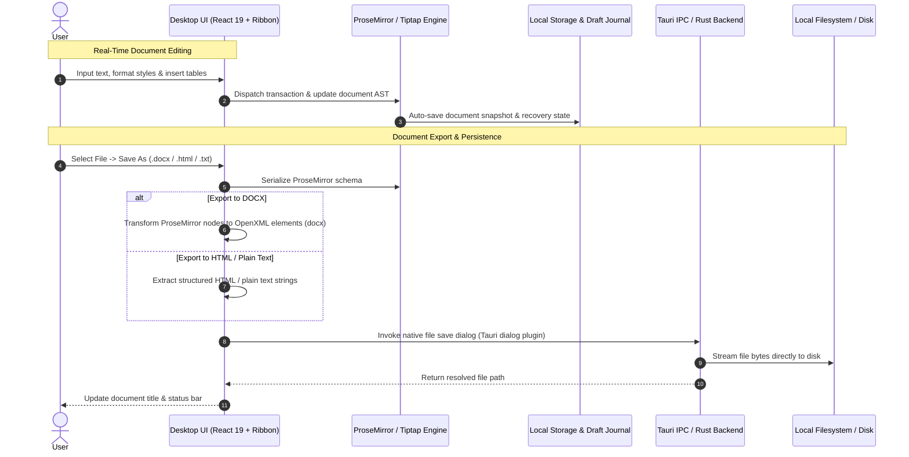

<p align="center">
  <a href="https://github.com/mizan989/wordo">
    
  </a>
</p>

<div align="center">

# Wordo

### The modern cross-platform desktop word processor & document editor. Native performance, distraction-free typography, bidirectional DOCX support, and privacy-first local storage powered by Tauri 2, React, and Rust.

<br/>

<a href="#-quick-start"></a>
<a href="https://github.com/mizan989/wordo/releases"></a>
<a href="https://github.com/mizan989/wordo/discussions"></a>

<a href="#-ways-to-run-wordo"></a>
<a href="#-quick-start"></a>

<a href="https://github.com/mizan989/wordo/stargazers"></a>
<a href="LICENSE"></a>
<a href="https://tauri.app"></a>
<a href="https://www.rust-lang.org"></a>
<a href="https://react.dev"></a>
<a href="https://www.typescriptlang.org"></a>
<a href="https://tiptap.dev"></a>
<a href="https://vite.dev"></a>

</div>

> [!TIP]
> **Native Desktop Performance & Complete Privacy!** Wordo operates 100% locally on your workstation with zero external telemetry, zero forced cloud accounts, and sub-30MB baseline RAM consumption. [Get started locally in under 60 seconds](#-quick-start).

---

## Wordo Overview

Wordo is an independent, high-performance desktop word processor engineered with **Tauri 2**, **React 19**, **TypeScript**, and **Rust**. Designed to replace bloated, sluggish office suites with an agile and distraction-free native experience, Wordo unites desktop-grade responsiveness, an intuitive ribbon workflow, and advanced ProseMirror/Tiptap document architecture.

Unlike cloud-locked document platforms, Wordo treats privacy as non-negotiable: all documents, drafts, templates, and revision snapshots remain strictly on your local filesystem. With bidirectional Microsoft Word DOCX import/export, customizable page geometries, and instant print-to-PDF output, Wordo offers a seamless bridge between modern speed and industry-standard interoperability.

**Key Capabilities:**

- **Native Desktop Architecture** — Powered by Tauri 2 and Rust for instant sub-second boot times, native windowing, and minimal RAM footprint (<30MB vs 500MB+ in typical Electron alternatives)
- **Word-Fidelity Typography & Metrics** — Precision formatting engine supporting exact point spacing (`marginTop`/`marginBottom`), paragraph borders, outline text effects (`wdOutline`), 0.5-inch dynamic tab stops (`TabNode`), and `hhea`-calibrated Word-to-CSS line spacing (`fontMetrics.ts`)
- **Custom User Font Manager ("Import My Fonts")** — Import local `.ttf`, `.otf`, and `.ttc` font collections directly into local IndexedDB storage (`userFonts.ts`), automatically splitting font collections, extracting exact line metrics, and registering faces via the browser `FontFace` API without system-wide installation
- **High-Fidelity Bidirectional DOCX Engine** — Direct OpenXML/OOXML importer (`docxImport.ts`) preserving fonts, sizes, colors, alignments, spacing, indentations, paragraph/table cell borders, tab stops, lists, images, links, and page geometry (with Mammoth fallback), paired with native `.docx` export via the `docx` library
- **Reactive Multi-Tab Ribbon & Floating Toolbars** — Multi-tab command ribbon (`Home`, `Insert`, `Layout`, `References`, `Review`, `View`, `Help`, plus contextual `Table`), selection-aware font/size controls, right-click context menu, and floating mini formatting bar
- **Advanced Table Studio** — Interactive data tables preserving imported cell borders, padding, vertical alignment, background shading, row heights, row/column editing, and header toggles
- **Themeable Desktop UI & Locked Paper Ink** — Refined light and dark themes with crisp white document paper contrast (`#1D1D1F` locked print ink regardless of UI theme), sepia/dark paper presets, and distraction-free Focus Mode
- **Review, Proofing & Productivity Tools** — Built-in spell/style checker (`SpellCheckPanel`), Find & Replace with live document match highlighting, Citations & Bibliography manager, Translation assistant, Read Aloud text-to-speech bar, and Accessibility checker
- **Precise Document Geometry & Export** — Configurable paper sizes (A4, Letter, Legal), portrait/landscape orientations, custom margins, interactive horizontal ruler, and one-click export to DOCX, HTML, TXT, rasterized PDF, or native Print-to-PDF
- **Crash-Resilient Draft Recovery** — Real-time draft journaling with automatic recovery banners protecting your work against unexpected shutdowns
- **Curated Template Library** — Ready-to-write presets for Corporate NDAs, Financial Reports, SOP Manuals, Software RFCs, Project Proposals, Executive Resumes, Business Letters, Employee Handbooks, and Academic Manuscripts

<br>

<div align="center">
  <pre>
┌─────────────────────────────────────────────────────────────────────────────────┐
│                                     WORDO                                       │
│       Tauri 2 Native Core ➔ Rust IPC ➔ React 19 UI ➔ Tiptap / ProseMirror       │
├───────────────────────────────┬─────────────────────────────────────────────────┤
│  🖥️ Native System Runtime     │  📝 Rich Document Engine                        │
│   • Lightweight Rust backend  │    [Interactive Document Canvas]                │
│   • Native OS dialogs & menus │       ├── Semantic ProseMirror Document Model   │
│   • Sub-30MB RAM idle memory  │       ├── Real-Time Pagination & Geometry       │
├───────────────────────────────┼─────────────────────────────────────────────────┤
│  🔒 Privacy & Local Storage   │  🔄 Document Interoperability                   │
│   • 100% offline & local data │    • High-Fidelity DOCX Import & Export         │
│   • Auto-save draft recovery  │    • Native PDF & Platform Print Engine         │
└───────────────────────────────┴─────────────────────────────────────────────────┘
  </pre>
</div>

---

## UI Preview

<p align="center">
  
</p>

<div align="center">
  <table>
    <tr>
      <td width="50%" align="center">
        
        <br />
        <em>Page Layout & Paper Geometry</em>
      </td>
      <td width="50%" align="center">
        
        <br />
        <em>Insert & Rich Media Formatting</em>
      </td>
    </tr>
    <tr>
      <td width="50%" align="center">
        
        <br />
        <em>Navigation Sidebar & Document Structure</em>
      </td>
      <td width="50%" align="center">
        
        <br />
        <em>Native Dark Mode with Paper Contrast</em>
      </td>
    </tr>
  </table>
</div>

---

## Document Lifecycle & Processing Flow



---

## Use Cases

- **Academic & Research Papers** — Draft structured papers with clear heading hierarchies, footnotes, formatted tables, and bibliography references
- **Executive Correspondence & Proposals** — Produce client-ready business proposals, invoices, and executive memos with built-in templates
- **Distraction-Free Authoring** — Focus on long-form manuscripts and creative writing in an uncluttered, responsive environment
- **Rapid DOCX Review & Conversion** — Open, inspect, edit, and convert incoming Microsoft Word documents locally without requiring an active Office 365 subscription
- **Secure & Regulated Work environments** — Ideal for healthcare, legal, or air-gapped corporate setups where documents must never leave on-premise hardware

---

## 🚀 Quick Start

**Prerequisites:**
- **Node.js**: 18.x or higher (Node 20+ recommended)
- **Python**: 3.11+ (used by `scripts/generate_site.py` during production builds)
- **Rust Toolchain**: `rustc` and `cargo` (1.80+ recommended)
- **Linux Dependencies** *(Linux only)*:
  ```bash
  sudo apt install libwebkit2gtk-4.1-dev build-essential curl wget libssl-dev libgtk-3-dev libayatana-appindicator3-dev librsvg2-dev
  ```

### Installation & Development

```bash
# 1. Clone the repository
git clone https://github.com/mizan989/wordo.git
cd wordo/app

# 2. Install frontend dependencies
npm install

# 3. Start development
# Mode A: Instant Web Preview in Browser
npm run dev

# Mode B: Native Desktop App with Hot Reloading (Tauri + Rust)
npm run tauri:dev
```

Open **[http://localhost:5173](http://localhost:5173)** in your browser when running Web Mode, or interact directly with the native desktop window in Tauri mode.

---

## Ways to Run Wordo

- **Native Desktop Application** — Full native desktop experience on Linux, macOS, and Windows with native file dialogs and window decorations. [Quick Start](#-quick-start)
- **Local Web Browser Mode** — Run the editor canvas directly in any modern browser via Vite (`npm run dev`).
- **Production Static Site & Web Tools** — Generate the static deployment bundle containing dedicated tools for spell-checking, grammar checking, and word counting (`npm run build`).

---

## 📄 Workspaces & Core Components

Wordo provides a clean, neutral desktop interface with macOS-inspired ergonomics and an interactive ribbon workspace:

- **Adaptive Multi-Tab Ribbon Toolbar** — Reactive command ribbon (`Home`, `Insert`, `Layout`, `References`, `Review`, `View`, `Help`, plus contextual `Table`) that syncs immediately with cursor selection and block formatting, alongside a quick File dropdown and Backstage view.
- **Dynamic Editor Canvas & Context Tools** — Calibrated multi-page canvas supporting live margins, visual paper themes (white with locked print ink, sepia, dark), watermarks, inline context menu, and a floating mini formatting toolbar.
- **Custom Font Manager ("My Fonts")** — Dedicated `FontManagerDialog` for importing local `.ttf`, `.otf`, and `.ttc` font files or font folders directly into IndexedDB (`userFonts.ts`), automatically splitting font collections and registering true `FontFace` instances and line-height metrics.
- **Word-Fidelity Extensions & Interactive Ruler** — Drag-and-drop horizontal margin ruler (`Ruler.tsx`), real 0.5-inch dynamic inline tab stops (`wordFidelity.ts`), exact point spacing, paragraph borders, and outline text effects (`typography.ts`).
- **Document Settings & Presets** — Configure paper sizes (`A4`, `Letter`, `Legal`), portrait/landscape orientation, margin profiles (`Normal`, `Narrow`, `Wide`, or custom), watermarks, and header/footer presets (`Corporate Standard`, `Executive Briefing`, `Legal & Compliance`, `Academic & Research`, `Blank / Minimal`).
- **Navigation Sidebar, Proofing & Read Aloud** — Real-time headings outline & Find/Replace sidebar (`NavigationSidebar.tsx`), spelling/style assistant (`SpellCheckPanel.tsx`), Citations manager, Translation modal, Accessibility checker, and Read Aloud text-to-speech control bar.
- **Status Bar, Template Gallery & Recovery Banner** — Live word/character counts, proofing status, Focus Mode toggle, zoom slider, starter template gallery (`TemplateModal.tsx`), and crash recovery banner (`RecoveryBanner.tsx`).

---

## ✨ What's New in v2.0.x & Core Architecture

### Recent Feature Highlights (v2.0.0 – v2.0.4)

- **Clean Neutral UI & Locked Print Ink** — Refined light and dark themes powered by `@astryxdesign/theme-neutral`, keeping document paper ink locked to black (`#1D1D1F`) by default across UI themes with clean focus handling and sanitized PDF exports.
- **High-Fidelity OOXML Styled DOCX Importer (`docxImport.ts`)** — Direct ZIP/OOXML parser reading fonts, sizes, colors, alignment, paragraph spacing/indents, borders, lists, tables, images, links, and page setup, with automatic Mammoth fallback and missing-font warnings.
- **Word Typography & Font Metrics Parity (`fontMetrics.ts`, `wordFidelity.ts`)** — `hhea`-calibrated Word-to-CSS line-height conversion, inline 0.5-inch `TabNode` stops, paragraph/cell inline styles, and `wdOutline` text effects.
- **Reactive Ribbon & Selection Tracking (`RibbonToolbar.tsx`)** — Live `selectionUpdate`/`transaction` subscriptions resolving run-level and block-level fonts/sizes while displaying custom document fonts in the selector.
- **Local "Import My Fonts" Registry (`userFonts.ts`, `FontManagerDialog.tsx`)** — Import `.ttf`, `.otf`, and `.ttc` font collections into local IndexedDB storage with automatic line-factor extraction so Word documents match desktop Word typography.

### High-Performance Native Architecture

Wordo replaces the heavy Chromium-and-Node bundle of legacy desktop word processors with Tauri 2.0:

```text
User Actions ➔ React 19 Frontend ➔ Tauri Webview (WebKit / WebView2)
                       │
             IPC Commands & File I/O
                       │
                       ▼
             Rust Native Backend Core
                       │
             Native OS Filesystem & Dialogs
```

### Modern Full-Stack Tech Stack

| Layer | Technologies | Purpose |
|---|---|---|
| **Desktop Framework** | Tauri 2.0, Rust | Native application windowing, IPC, and high-performance system bindings |
| **Frontend Runtime** | React 19, TypeScript, Vite 8 | Reactive component architecture and sub-second HMR development |
| **Editor Core** | Tiptap 3, ProseMirror (`@tiptap/pm`) | Extensible schema-driven rich text engine and custom nodes/plugins |
| **Design & Icons** | Tailwind CSS v4, `@astryxdesign/theme-neutral`, Lucide Icons | Adaptive neutral light/dark surfaces and consistent vector iconography |
| **Document Processing** | `docx`, JSZip, Mammoth (fallback) | Direct OOXML DOCX styled import/export and schema transformation |
| **Font Engine** | FontFace API, IndexedDB, Binary SFNT/`ttcf` Parser | Client-side `.ttf`/`.otf`/`.ttc` user font import and `hhea` line metrics |
| **Export Engines** | jsPDF, html2canvas, Native Print | Raster PDF export (`jsPDF`) and native platform print-to-PDF dialog |
| **Static Site Generator**| Python 3 (`generate_site.py`) | Production static landing pages and standalone browser utility tools |

---

## ⚙️ Configuration

### Tauri Configuration (`app/src-tauri/tauri.conf.json`)

The application identity, window dimensions, and capability permissions are defined in `tauri.conf.json`:

```json
{
  "productName": "Wordo",
  "version": "2.0.4",
  "identifier": "com.wordclient.desktop",
  "app": {
    "windows": [
      {
        "title": "Wordo",
        "width": 1280,
        "height": 860,
        "minWidth": 800,
        "minHeight": 600,
        "resizable": true
      }
    ]
  }
}
```

### Header & Footer Presets (`app/src/types/presets.ts`)

Header, footer, and page-numbering templates can be customized in `presets.ts`:

- **Corporate Standard**, **Executive Briefing**, **Legal & Compliance**, **Academic & Research**, and **Blank / Minimal**
- Paper formats (**A4**, **Letter**, **Legal**) and margin profiles (**Normal**, **Narrow**, **Wide**, or custom values) are configured directly through `DocumentSettingsModal.tsx` and the Layout ribbon.

---

## Architecture & Code Structure

```text
wordo/
├── .github/workflows/         # Automated CI checks (ci.yml) & multi-platform releases (release.yml)
├── docs/screenshots/          # High-resolution UI showcase screenshots (1920x1014)
├── app/
│   ├── public/
│   │   ├── favicon.ico        # Multi-resolution favicon icon
│   │   └── static/            # Static card assets and bundled MS/Segoe UI font files
│   ├── scripts/
│   │   ├── generate_site.py   # Multi-page marketing & utility tool generator
│   │   ├── run_generate.js    # Cross-platform site generation runner
│   │   └── site_templates/    # HTML templates and route captures
│   ├── src/
│   │   ├── assets/            # Wordo branding logo and visual assets
│   │   ├── components/        # UI components & dialogs
│   │   │   ├── TitleBar.tsx              # Custom desktop titlebar with quick actions & theme toggle
│   │   │   ├── RibbonToolbar.tsx         # Multi-tab ribbon (Home..Help + Table)
│   │   │   ├── FileMenuDropdown.tsx      # File quick menu
│   │   │   ├── BackstageView.tsx         # Full-screen file & template backstage view
│   │   │   ├── EditorCanvas.tsx          # Multi-page ProseMirror canvas & paper sheet
│   │   │   ├── EditorContextMenu.tsx     # Context menu for editing, tables & proofing
│   │   │   ├── FloatingMiniToolbar.tsx   # Selection-triggered mini formatting bar
│   │   │   ├── FontManagerDialog.tsx     # Custom user font (.ttf/.otf/.ttc) manager
│   │   │   ├── NavigationSidebar.tsx     # Headings outline & Find/Replace panel
│   │   │   ├── SpellCheckPanel.tsx       # Spelling & style assistant
│   │   │   ├── ReadAloudBar.tsx          # Text-to-speech playback controls
│   │   │   ├── Ruler.tsx                 # Interactive horizontal margin ruler
│   │   │   ├── StatusBar.tsx             # Word count, proofing indicator, Focus Mode & zoom
│   │   │   ├── DocumentSettingsModal.tsx # Paper size, orientation, margins & presets
│   │   │   ├── TemplateModal.tsx         # Template gallery modal
│   │   │   ├── RecoveryBanner.tsx        # Auto-saved draft restore prompt
│   │   │   └── *Modal.tsx / *Dialog.tsx  # About, Accessibility, Citation, Date/Time, Shortcuts,
│   │   │                                 # Symbol, Translate, WordCount & CloseConfirm dialogs
│   │   ├── extensions/        # Custom Tiptap extensions
│   │   │   ├── pageBreak.ts              # Explicit document page break node
│   │   │   ├── searchHighlight.ts        # Live find-and-replace match highlighter
│   │   │   ├── typography.ts             # Word point spacing, borders, outline & fonts
│   │   │   └── wordFidelity.ts           # Inline 0.5in TabNode stops & table cell styling
│   │   ├── services/          # Core operational services
│   │   │   ├── docxImport.ts             # Direct styled OOXML (.docx) reader
│   │   │   ├── docxService.ts            # DOCX import orchestrator & OpenXML (.docx) exporter
│   │   │   ├── fontMetrics.ts            # Font availability & Word-to-CSS line-height factors
│   │   │   ├── userFonts.ts              # IndexedDB font store, SFNT parser & TTC splitter
│   │   │   ├── pdfService.ts             # PDF export (jsPDF + html2canvas) & native print
│   │   │   ├── platform.ts               # Unified Tauri IPC / Browser fallback abstraction
│   │   │   ├── spellService.ts           # Document metrics & spell/grammar analyzer
│   │   │   └── storageService.ts         # Draft journaling, recent files & recovery vault
│   │   ├── templates/         # Built-in document starter templates
│   │   ├── types/             # Document settings, stats & header/footer presets
│   │   ├── App.tsx            # Root application layout and state coordinator
│   │   ├── index.css          # Neutral theme tokens, Tailwind styles & ProseMirror layout
│   │   └── ms-fonts.css       # Bundled Microsoft font-face declarations
│   │
│   ├── src-tauri/             # Rust desktop backend
│   │   ├── capabilities/      # Tauri permission capabilities
│   │   ├── icons/             # Multi-platform app icons (PNG, ICO, ICNS)
│   │   ├── src/
│   │   │   ├── commands.rs    # Sandboxed file dialogs, I/O & system commands
│   │   │   └── main.rs        # Native desktop entry point
│   │   ├── Cargo.toml         # Rust dependencies (tauri v2, serde, rfd)
│   │   └── tauri.conf.json    # Application metadata and window configuration
│   │
│   ├── package.json           # Frontend dependencies and build scripts
│   └── vite.config.ts         # Vite bundler configuration
│
├── LICENSE                    # MIT License
└── README.md                  # Project documentation
```

---

## 📦 Packaging & Installation

### Build Desktop Bundles

Compile native platform installers using the Tauri CLI:

```bash
cd app
npm run tauri:build
```

### Linux Installation (Debian / Ubuntu / RPM / AppImage)

Download the latest release from [GitHub Releases](https://github.com/mizan989/wordo/releases), or install the compiled local `.deb` package directly:

```bash
sudo apt install ./app/src-tauri/target/release/bundle/deb/Wordo_2.0.4_amd64.deb
```

For Fedora/RHEL systems, install the `.rpm` package, or run the portable `.AppImage` binary directly on any modern Linux distribution. Windows (`.exe` / `.msi`) and macOS (`.dmg` / `.app`) installers are also published on [GitHub Releases](https://github.com/mizan989/wordo/releases).

---

## Verification & Quality Bar

Validate codebase integrity and build status (matching the CI pipeline in `.github/workflows/ci.yml`):

```bash
# Typecheck TypeScript codebase
cd app && npx tsc --noEmit

# Build production frontend bundle & generate web pages
cd app && npm run build

# Validate Rust backend compilation & tests
cd app/src-tauri && cargo check && cargo test
```

---

## 🛡️ Reliability & Document Integrity

- **Non-Destructive Draft Recovery:** Active edits are continuously saved into browser/desktop local storage. In case of unexpected termination, Wordo presents an instant restore banner upon reopen.
- **Sanitized DOCX & Font Import:** Incoming DOCX files are safely converted into semantic HTML by the OOXML reader (`docxImport.ts`) and parsed against strict Tiptap schema rules; imported user fonts remain isolated inside local IndexedDB storage.
- **Sandboxed Native Permissions:** Tauri 2 capabilities strictly normalize paths, guard against symlink traversal, and scope filesystem operations to user-selected directories.
- **Zero External Telemetry:** Wordo makes no background network requests, tracking beacons, or telemetry calls during document editing.

---

## Contributing

We welcome community contributions! Whether you're enhancing the table editor, optimizing DOCX styling round-trips, or adding language localizations:

1. Fork the repository
2. Create your feature branch (`git checkout -b feature/enhanced-table-resizing`)
3. Commit your changes (`git commit -m 'Add interactive table column drag resizing'`)
4. Push to the branch (`git push origin feature/enhanced-table-resizing`)
5. Open a [Pull Request](https://github.com/mizan989/wordo/pulls)

---

## Support the Project

**Enjoying Wordo?** Give us a ⭐ on [GitHub](https://github.com/mizan989/wordo) to help support lightweight, open-source productivity software!

---

## Acknowledgements

Wordo is built with gratitude towards the open-source software ecosystem:

- [Tauri](https://tauri.app/) — Next-generation native desktop framework
- [Rust](https://www.rust-lang.org/) — Memory-safe systems programming language
- [React](https://react.dev/) & [Vite](https://vite.dev/) — Lightning-fast frontend library and build tool
- [Tiptap](https://tiptap.dev/) & [ProseMirror](https://prosemirror.net/) — Headless, extensible rich-text editing engine
- [JSZip](https://stuk.github.io/jszip/), [Mammoth.js](https://github.com/mwilliamson/mammoth.js) & [docx](https://docx.js.org/) — OpenXML DOCX parsing and generation libraries
- [jsPDF](https://github.com/parallax/jsPDF) & [html2canvas](https://html2canvas.hertzen.com/) — Client-side PDF export rendering
- [Tailwind CSS](https://tailwindcss.com/) & [Astryx Neutral](https://www.npmjs.com/package/@astryxdesign/theme-neutral) — Utility styling and neutral surface tokens
- [Lucide Icons](https://lucide.dev/) — Clean, consistent UI iconography

<div align="center">

> [!NOTE]
> **Product Notice:** Wordo is an independent desktop word processor. It is not affiliated with, endorsed by, or a client for Microsoft Word. All trademarks belong to their respective owners.

</div>
