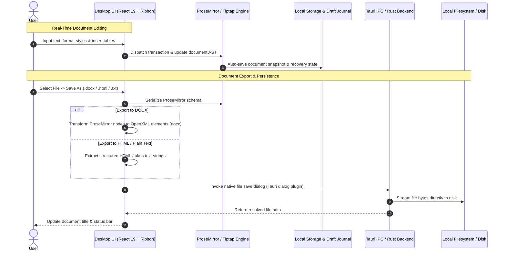

<p align="center">
  <a href="https://github.com/mizan989/wordo">
    
  </a>
</p>

<div align="center">

# Wordo

### The modern cross-platform desktop word processor & document editor. Native performance, distraction-free typography, bidirectional DOCX support, and privacy-first local storage powered by Tauri 2, React, and Rust.

<br/>

<a href="#-quick-start"></a>
<a href="https://github.com/mizan989/wordo/releases"></a>
<a href="https://github.com/mizan989/wordo/discussions"></a>

<a href="#-ways-to-run-wordo"></a>
<a href="#-quick-start"></a>

<a href="https://github.com/mizan989/wordo/stargazers"></a>
<a href="LICENSE"></a>
<a href="https://tauri.app"></a>
<a href="https://www.rust-lang.org"></a>
<a href="https://react.dev"></a>
<a href="https://www.typescriptlang.org"></a>
<a href="https://tiptap.dev"></a>
<a href="https://vite.dev"></a>

</div>

> [!TIP]
> **Native Desktop Performance & Complete Privacy!** Wordo operates 100% locally on your workstation with zero external telemetry, zero forced cloud accounts, and sub-30MB baseline RAM consumption. [Get started locally in under 60 seconds](#-quick-start).

---

## Wordo Overview

Wordo is an independent, high-performance desktop word processor engineered with **Tauri 2**, **React 19**, **TypeScript**, and **Rust**. Designed to replace bloated, sluggish office suites with an agile and distraction-free native experience, Wordo unites desktop-grade responsiveness, an intuitive ribbon workflow, and advanced ProseMirror/Tiptap document architecture.

Unlike cloud-locked document platforms, Wordo treats privacy as non-negotiable: all documents, drafts, templates, and revision snapshots remain strictly on your local filesystem. With bidirectional Microsoft Word DOCX import/export, customizable page geometries, and instant print-to-PDF output, Wordo offers a seamless bridge between modern speed and industry-standard interoperability.

**Key Capabilities:**

- **Native Desktop Architecture** — Powered by Tauri 2 and Rust for instant sub-second boot times, native windowing, and minimal RAM footprint (<30MB vs 500MB+ in typical Electron alternatives)
- **Rich Document Typography** — Full-spectrum formatting engine supporting styled headings, nested task lists, blockquotes, inline callouts, code syntax, and custom accent highlights
- **Advanced Table Studio** — Full interactive data tables with row/column insertion, deletion, table resizing, header toggles, and cell alignments
- **Bidirectional DOCX Engine** — Import DOCX documents via Mammoth and compile rich documents directly to native OpenXML (`.docx`) through the `docx` library
- **Precise Document Geometry** — Configurable paper sizes (A4, Letter, Legal, Tabloid), portrait/landscape orientations, custom page margins, and dedicated page breaks
- **Multi-Format Export & Print Engine** — One-click export to DOCX, HTML, Markdown, and TXT, paired with native platform vector print and PDF output
- **Crash-Resilient Draft Recovery** — Real-time draft journaling with automatic recovery banners protecting your work against unexpected power cuts or reboots
- **Curated Template Library** — Ready-to-write presets for business letters, executive resumes, modern project proposals, research reports, and meeting summaries

<br>

<div align="center">
  <pre>
┌─────────────────────────────────────────────────────────────────────────────────┐
│                                     WORDO                                       │
│       Tauri 2 Native Core ➔ Rust IPC ➔ React 19 UI ➔ Tiptap / ProseMirror       │
├───────────────────────────────┬─────────────────────────────────────────────────┤
│  🖥️ Native System Runtime     │  📝 Rich Document Engine                        │
│   • Lightweight Rust backend  │    [Interactive Document Canvas]                │
│   • Native OS dialogs & menus │       ├── Semantic ProseMirror Document Model   │
│   • Sub-30MB RAM idle memory  │       ├── Real-Time Pagination & Geometry       │
├───────────────────────────────┼─────────────────────────────────────────────────┤
│  🔒 Privacy & Local Storage   │  🔄 Document Interoperability                   │
│   • 100% offline & local data │    • High-Fidelity DOCX Import & Export         │
│   • Auto-save draft recovery  │    • Native PDF & Platform Print Engine         │
└───────────────────────────────┴─────────────────────────────────────────────────┘
  </pre>
</div>

---

## UI Preview

<p align="center">
  
</p>

---

## Document Lifecycle & Processing Flow



---

## Use Cases

- **Academic & Research Papers** — Draft structured papers with clear heading hierarchies, footnotes, formatted tables, and bibliography references
- **Executive Correspondence & Proposals** — Produce client-ready business proposals, invoices, and executive memos with built-in templates
- **Distraction-Free Authoring** — Focus on long-form manuscripts and creative writing in an uncluttered, responsive environment
- **Rapid DOCX Review & Conversion** — Open, inspect, edit, and convert incoming Microsoft Word documents locally without requiring an active Office 365 subscription
- **Secure & Regulated Work environments** — Ideal for healthcare, legal, or air-gapped corporate setups where documents must never leave on-premise hardware

---

## 🚀 Quick Start

**Prerequisites:**
- **Node.js**: 18.x or higher (Node 20+ recommended)
- **Rust Toolchain**: `rustc` and `cargo` (1.80+ recommended)
- **Linux Dependencies** *(Linux only)*:
  ```bash
  sudo apt install libwebkit2gtk-4.1-dev build-essential curl wget libssl-dev libgtk-3-dev libayatana-appindicator3-dev librsvg2-dev
  ```

### Installation & Development

```bash
# 1. Clone the repository
git clone https://github.com/mizan989/wordo.git
cd wordo/app

# 2. Install frontend dependencies
npm install

# 3. Start development
# Mode A: Instant Web Preview in Browser
npm run dev

# Mode B: Native Desktop App with Hot Reloading (Tauri + Rust)
npm run tauri:dev
```

Open **[http://localhost:5173](http://localhost:5173)** in your browser when running Web Mode, or interact directly with the native desktop window in Tauri mode.

---

## Ways to Run Wordo

- **Native Desktop Application** — Full native desktop experience on Linux, macOS, and Windows with native file dialogs and window decorations. [Quick Start](#-quick-start)
- **Local Web Browser Mode** — Run the editor canvas directly in any modern browser via Vite (`npm run dev`).
- **Production Static Site & Web Tools** — Generate the static deployment bundle containing dedicated tools for spell-checking, grammar checking, and word counting (`npm run build`).

---

## 📄 Workspaces & Core Components

Wordo provides an intuitive interface inspired by classic productivity suites yet refined with modern design principles:

- **Adaptive Ribbon Toolbar** — Multi-tab command ribbon (Home, Insert, Layout, View) organizing character styling, alignment, headers, media, tables, and page setup.
- **Dynamic Editor Canvas** — Calibrated document page container supporting live margin boundaries, visual paper presets, and seamless zoom controls (50% to 200%).
- **Document Settings Modal** — Precise document configuration: paper sizes (Letter, A4, Legal, Tabloid), orientation, margin presets (Normal, Narrow, Wide), and custom values.
- **Template Gallery** — One-click starter layouts for business letters, technical project outlines, resume drafts, and meeting minutes.
- **Navigation & Outline Sidebar** — Real-time table of contents dynamically indexing headings for instant navigation across long documents.
- **Status Bar & Live Metrics** — Always-visible word count, character count, page estimates, zoom controller, and save state status indicators.
- **Recovery Banner** — Intelligent banner notifying you of unsaved sessions, enabling one-click restoration of previous drafting states.

---

## ✨ Features

### High-Performance Native Architecture

Wordo replaces the heavy Chromium-and-Node bundle of legacy desktop word processors with Tauri 2.0:

```text
User Actions ➔ React 19 Frontend ➔ Tauri Webview (WebKit / WebView2)
                       │
             IPC Commands & File I/O
                       │
                       ▼
             Rust Native Backend Core
                       │
             Native OS Filesystem & Dialogs
```

### Modern Full-Stack Tech Stack

| Layer | Technologies | Purpose |
|---|---|---|
| **Desktop Framework** | Tauri 2.0, Rust | Native application windowing, IPC, and high-performance system bindings |
| **Frontend Runtime** | React 19, TypeScript, Vite 8 | Reactive component architecture and sub-second HMR development |
| **Editor Core** | Tiptap 3, ProseMirror | Extensible schema-driven rich text document engine |
| **Styling & Icons** | Tailwind CSS, Lucide Icons | Clean, responsive interface typography and vector iconography |
| **Document Processing** | `docx`, Mammoth | OpenXML DOCX parsing, generation, and formatting transformation |
| **Export Engines** | jsPDF, html2canvas, Native Print | Vector PDF rendering and platform print dialog integration |
| **Static Site Generator**| Python 3 (`generate_site.py`) | Production static marketing pages and standalone utility tools |

---

## ⚙️ Configuration

### Tauri Configuration (`app/src-tauri/tauri.conf.json`)

The application identity, window dimensions, and capability permissions are defined in `tauri.conf.json`:

```json
{
  "productName": "Wordo",
  "version": "1.0.0",
  "identifier": "com.wordclient.desktop",
  "app": {
    "windows": [
      {
        "title": "Wordo",
        "width": 1280,
        "height": 840,
        "minWidth": 800,
        "minHeight": 600,
        "resizable": true
      }
    ]
  }
}
```

### Document Presets (`app/src/types/presets.ts`)

Paper geometry and margin presets can be customized in `presets.ts`:

- **Paper Formats**: Letter (8.5 × 11 in), A4 (210 × 297 mm), Legal (8.5 × 14 in), Tabloid (11 × 17 in)
- **Margin Profiles**: Normal (1 in), Narrow (0.5 in), Wide (1.5 in top/bottom, 2 in left/right)

---

## Architecture & Code Structure

```text
wordo/
├── app/
│   ├── public/
│   │   ├── favicon.ico        # Multi-resolution favicon icon
│   │   └── static/            # Static assets and local fonts
│   ├── scripts/
│   │   ├── generate_site.py   # Multi-page marketing & utility tool generator
│   │   └── postbuild.js       # Post-build packaging hook
│   ├── src/
│   │   ├── assets/            # Wordo branding logo and visual assets
│   │   ├── components/        # UI components
│   │   │   ├── RibbonToolbar.tsx         # Formatting ribbon (Home, Insert, Layout)
│   │   │   ├── EditorCanvas.tsx          # ProseMirror canvas & page container
│   │   │   ├── MenuBar.tsx               # Top-level application menu
│   │   │   ├── NavigationSidebar.tsx     # Headings outline navigator
│   │   │   ├── StatusBar.tsx             # Words, characters, and zoom controls
│   │   │   ├── DocumentSettingsModal.tsx # Margins, orientation, and paper size
│   │   │   ├── TemplateModal.tsx         # Template gallery selection
│   │   │   └── RecoveryBanner.tsx        # Auto-saved draft restore prompt
│   │   ├── extensions/        # Custom Tiptap extensions
│   │   │   ├── pageBreak.ts              # Explicit document page break node
│   │   │   └── typography.ts             # Typographic formatting rules
│   │   ├── services/          # Core operational services
│   │   │   ├── docxService.ts            # DOCX import (Mammoth) & export (docx)
│   │   │   ├── platform.ts               # Unified Tauri / Web native abstraction
│   │   │   ├── storageService.ts         # Draft journaling & auto-save engine
│   │   │   └── pdfService.ts             # PDF generation utilities
│   │   ├── templates/         # Built-in document starter templates
│   │   ├── types/             # Document, style, and preset TypeScript definitions
│   │   ├── App.tsx            # Root application layout and state coordinator
│   │   └── index.css          # Tailwind CSS styles and page layout rules
│   │
│   ├── src-tauri/             # Rust desktop backend
│   │   ├── capabilities/      # Tauri permission capabilities
│   │   ├── icons/             # Multi-platform app icons (PNG, ICO, ICNS)
│   │   ├── src/
│   │   │   ├── commands.rs    # Tauri command invocations
│   │   │   └── main.rs        # Native desktop entry point
│   │   ├── Cargo.toml         # Rust dependencies (tauri v2, serde)
│   │   └── tauri.conf.json    # Application metadata and window configuration
│   │
│   ├── package.json           # Frontend dependencies and build scripts
│   └── vite.config.ts         # Vite bundler and plugin configuration
│
└── README.md                  # Project documentation
```

---

## 📦 Packaging & Installation

### Build Desktop Bundles

Compile native platform installers using the Tauri CLI:

```bash
cd app
npm run tauri:build
```

### Linux Installation (Debian / Ubuntu)

Install the compiled `.deb` package directly:

```bash
sudo apt install ./app/src-tauri/target/release/bundle/deb/Wordo_1.0.0_amd64.deb
```

For portable execution on any modern Linux distribution, use the generated `.AppImage` binary.

---

## Verification & Quality Bar

Validate codebase integrity and build status:

```bash
# Typecheck TypeScript codebase
cd app && npx tsc --noEmit

# Build production frontend bundle & generate web pages
cd app && npm run build

# Validate Rust backend compilation
cd app/src-tauri && cargo check
```

---

## 🛡️ Reliability & Document Integrity

- **Non-Destructive Draft Recovery:** Active edits are continuously saved into browser/desktop local storage. In case of unexpected termination, Wordo presents an instant restore banner upon reopen.
- **Sanitized DOCX Import:** Incoming DOCX files are safely converted into semantic HTML via Mammoth and parsed against strict Tiptap schema rules, preventing arbitrary script injection.
- **Sandboxed Native Permissions:** Tauri 2 capabilities strictly scope filesystem dialogs and operations to authorized user directories.
- **Zero External Telemetry:** Wordo makes no background network requests, tracking beacons, or telemetry calls during document editing.

---

## Contributing

We welcome community contributions! Whether you're enhancing the table editor, optimizing DOCX styling round-trips, or adding language localizations:

1. Fork the repository
2. Create your feature branch (`git checkout -b feature/enhanced-table-resizing`)
3. Commit your changes (`git commit -m 'Add interactive table column drag resizing'`)
4. Push to the branch (`git push origin feature/enhanced-table-resizing`)
5. Open a [Pull Request](https://github.com/mizan989/wordo/pulls)

---

## Support the Project

**Enjoying Wordo?** Give us a ⭐ on [GitHub](https://github.com/mizan989/wordo) to help support lightweight, open-source productivity software!

---

## Acknowledgements

Wordo is built with gratitude towards the open-source software ecosystem:

- [Tauri](https://tauri.app/) — Next-generation native desktop framework
- [Rust](https://www.rust-lang.org/) — Memory-safe systems programming language
- [React](https://react.dev/) & [Vite](https://vite.dev/) — Lightning-fast frontend library and build tool
- [Tiptap](https://tiptap.dev/) & [ProseMirror](https://prosemirror.net/) — Headless, extensible rich-text editing engine
- [Mammoth.js](https://github.com/mwilliamson/mammoth.js) & [docx](https://docx.js.org/) — Powerful OpenXML DOCX conversion libraries
- [Tailwind CSS](https://tailwindcss.com/) — Modern utility-first styling engine
- [Lucide Icons](https://lucide.dev/) — Clean, consistent UI iconography

<div align="center">

> [!NOTE]
> **Product Notice:** Wordo is an independent desktop word processor. It is not affiliated with, endorsed by, or a client for Microsoft Word. All trademarks belong to their respective owners.

</div>
